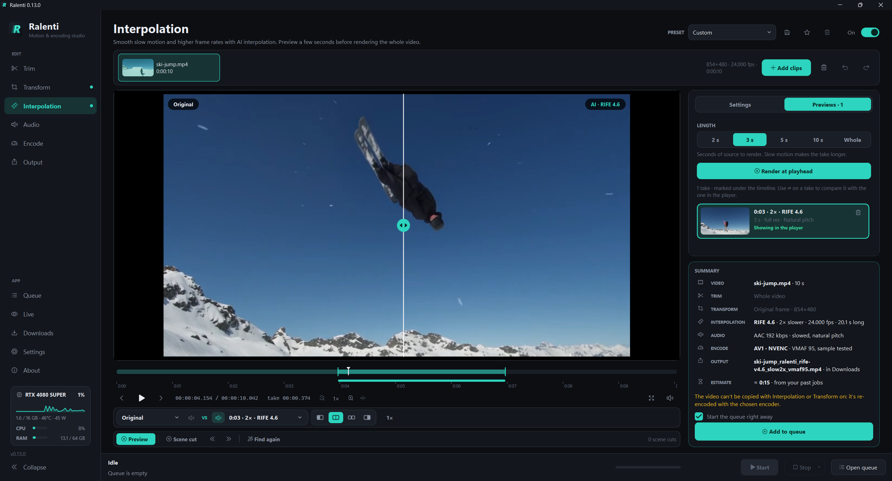

  

<h1 align="center">Ralenti</h1>

<b>Motion &amp; encoding studio</b> for Windows 
AI frame interpolation, quality-targeted encoding and lossless editing, in one editor and one queue. 
Free and open source, powered by RIFE.

  

---

## What it does

Open a video (or several clips to join them) and go through the steps in the sidebar. Each step shows the
result of the steps before it, and the summary always shows what the output will be.

| Step | What you get |
|---|---|
| **Trim** | As many cuts as you like; keep or remove each segment. Kept parts are joined automatically, losslessly when nothing else changes the picture. |
| **Transform** | Crop (drawn, or black bars detected), rotate, flip and resize, shown live in the player and on every later step. |
| **Interpolation** | Smooth slow motion and higher frame rates with RIFE. Render previews and compare them in the player; fix scene cuts on the timeline. |
| **Audio** | Every audio track with its waveform: keep one or several, natural or kept pitch with slow motion, and listen before rendering. |
| **Encode** | Copy as is, or encode to a **VMAF** quality target. Size and time estimates, an encoder comparison and a quality test with a zoomable still. |
| **Output** | File name templates with placeholders, container, overwrite or number, and a view of the folder the file goes to. |

| Page | What you get |
|---|---|
| **Queue** | Several jobs at once (or Auto), pause and resume, resume after failure, total ETA, taskbar progress, sleep or shut down when done. |
| **Live** | Watch an interpolation while it renders, with sound. |
| **Downloads** | One-click install and updates for FFmpeg and RIFE. |

**Highlights**

- Whole-edit presets in the header. Applying one lists exactly what changes, step by step. Ctrl+Z undoes it.
- Undo and redo for the whole edit; the edit is saved automatically.
- Exact frame rates: 29.97 becomes 59.94, not a jittery 60.
- Previews follow your trim, crop and rotation. Scene cuts are never blended.
- Disk-space prediction before queueing, plus a safety stop if a drive fills up.
- Resumable jobs: a long render isn't lost if the final encode fails.

## The AI engine: RIFE

Ralenti interpolates with **RIFE** (Real-Time Intermediate Flow Estimation), an open-source research
model, through rife-ncnn-vulkan:

- **Free and open source** (MIT). No account or license needed.
- **Runs on any Vulkan GPU**: NVIDIA, AMD or Intel.
- **One click** to install from the Downloads page; newer model versions appear automatically.
- An optional **quality boost** gives slightly cleaner motion at a lower speed.

Only the Interpolation step needs RIFE. Trimming, joining, transforming and encoding work without it.

## Requirements

- **Windows 10 or 11**, 64-bit.
- **FFmpeg, full build: required.** Ralenti downloads it for you on first launch (Gyan's full build),
  or you can point it to your own.
- **A GPU** for RIFE (any Vulkan-capable card). NVENC encoders need an NVIDIA card; AV1 NVENC needs
  RTX 40 or newer. CPU encoders work everywhere.

## Install

1. Download **Ralenti-x.y.z-setup.exe** from the Releases page and run it. No administrator rights
   are needed: it installs for your user only, unless you choose "all users".
2. Start Ralenti. The setup screen downloads FFmpeg and RIFE in one click each.
3. Open a video and press **Add to queue**.

Prefer no installer? Download **Ralenti-x.y.z-portable.zip**, unzip it anywhere and run Ralenti.exe.
Keep the whole folder together: Ralenti.exe needs the _internal folder beside it.

> Windows may show "Windows protected your PC" because the installer isn't code-signed yet.
> Click **More info**, then **Run anyway**.

## Quick start

1. Open a video, or drop it anywhere in the window. Add more clips to join them.
2. The default preset is **Slow-mo 2×**: newest RIFE model, natural-pitch audio, AV1 at VMAF 95.
3. On **Interpolation**, press **Preview** (P) to render a few seconds and compare them in the player.
4. Check the summary on the right and press **Add to queue**.

| Key | Where | What |
|---|---|---|
| Space, ← →, Shift+← → | everywhere | play, frame step, keyframe step |
| C, X, `,` `.` | Trim | add a cut, keep or remove the segment, previous / next cut |
| R, Shift+R, H, V, D, B | Transform | rotate, flip, draw the crop, before/after |
| P, S | Interpolation | preview, add or ignore a scene cut |
| Ctrl+Z, Ctrl+Y | everywhere | undo, redo |

## What is VMAF?

VMAF is a 0 to 100 score, created by Netflix, that predicts how closely a video matches the original
*to a human viewer*. Instead of guessing a quality number, Ralenti encodes a few short samples,
measures them and keeps the smallest file that still reaches your target. **95** is the usual
industry target: differences are rarely visible. The sample test costs some extra time; pick
**Constant quality** when speed matters more than file size. The **quality test** on the Encode step
shows the result on a still before you render.

## Troubleshooting

| Problem | Fix |
|---|---|
| "No AI engine yet" | Install RIFE (free) from **Downloads**. |
| RIFE fails or runs out of memory | Pick a smaller **Output size** in Transform, or update your GPU driver. |
| VMAF or black-bar detection unavailable | Install the full FFmpeg build from **Downloads**. |
| The player won't play a file | Processing still works; the built-in player supports fewer codecs than FFmpeg. |
| Not enough disk space | Change the temp folder in Settings, pick a smaller output size or use constant quality. |

Logs: **Settings > Diagnostics > Open logs**, or **Show log** in the menu of any job card.

## Where data lives

Everything is stored in %APPDATA%\Ralenti: settings, presets, the current edit, queue, logs, thumbnails,
temporary files and downloaded tools. The program folder is never written to. Nothing is sent anywhere,
except optional update checks that ask GitHub for the latest releases. Uninstalling asks whether to delete
this data too.

## Build from source

~~~bat
git clone https://github.com/Asterix404/ralenti.git
cd ralenti
python -m venv .venv
.venv\Scripts\activate
pip install -e .[dev]
pytest -q
python -m ralenti
~~~

Run **build.bat** to package it. It creates dist\Ralenti\ (the app), a portable zip and, if Inno
Setup 6 is installed (winget install JRSoftware.InnoSetup), the setup.exe. Pushing a tag like
v0.13.0 makes GitHub Actions build and publish both.

~~~text
ralenti/
  core/      edit model and job compiler, pipeline, queue, engines (RIFE), FFmpeg command builders,
             VMAF search (no UI code)
  ui/        PySide6 interface: the editor, pages, widgets, theme, icons
installer/   Inno Setup script
scripts/     icon checker, editor smoke test, extension checker, headless runners
tests/       pytest suite
~~~

Ralenti has a small engine interface (ralenti/core/engines.py): additional interpolation engines can
be registered by an optional extension package without changing the app. Install one from
Settings > Extensions; it's kept in %APPDATA%\Ralenti\extensions and survives app updates.
scripts\check_extension.py checks an extension against the current version.

## License

MIT for Ralenti's own code (see the LICENSE file). See THIRD_PARTY_NOTICES.md for the libraries and
tools it uses.
