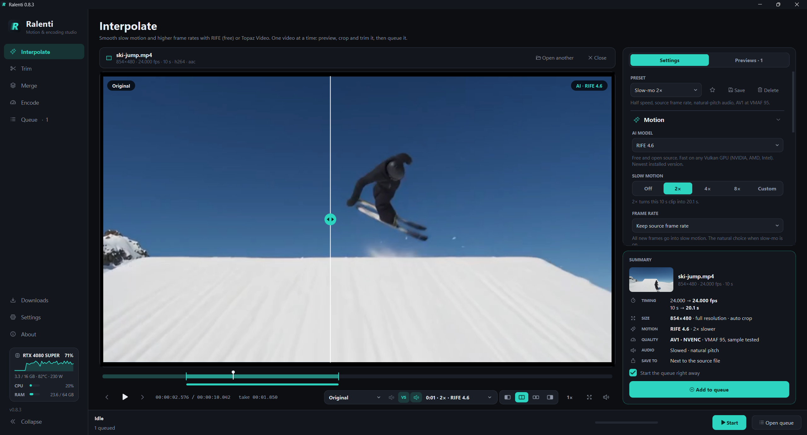

  

<h1 align="center">Ralenti</h1>

<b>Motion &amp; encoding studio</b> for Windows 
AI frame interpolation, quality-targeted encoding and lossless video tools, all in one queue. 
Free and open source, powered by RIFE.

  

---

## What it does

| Page | What you get |
|---|---|
| **Interpolate** | Smooth slow motion and higher frame rates with RIFE. Preview takes you can compare in the player, crop with black-bar detection, trim, presets. |
| **Trim** | Lossless cuts: no re-encode, instant, with keyframe snapping. |
| **Merge** | Joins clips losslessly when they match; converts them to one format when they don't. |
| **Encode** | Shrinks videos to a **VMAF** quality target: the smallest file that still looks like the original. |
| **Queue** | Step-by-step progress, resume after failure, total ETA, taskbar progress, sleep or shut down when done. |
| **Downloads** | One-click install and updates for FFmpeg and RIFE. |

**Highlights**

- Exact frame rates: 29.97 becomes 59.94, not a jittery 60.
- Slow-motion audio: natural pitch (like slowed film) or pitch kept (Rubber Band).
- Processing resolution: run the AI at 50% to turn 4K into fast 1080p jobs.
- Before/after and take-vs-take comparison in the player, with switchable audio.
- Disk-space prediction before queueing, plus a safety stop if a drive fills up.
- Live GPU, CPU and RAM meters.
- Resumable jobs: a long render isn't lost if the final encode fails.

## The AI engine: RIFE

Ralenti interpolates with **RIFE** (Real-Time Intermediate Flow Estimation), an open-source research
model, through rife-ncnn-vulkan:

- **Free and open source** (MIT). No account or license needed.
- **Runs on any Vulkan GPU**: NVIDIA, AMD or Intel.
- **One click** to install from the Downloads page; newer model versions appear automatically.
- An optional **quality boost** (Advanced settings) gives slightly cleaner motion at a lower speed.

Trim, Merge and Encode don't need RIFE at all.

## Requirements

- **Windows 10 or 11**, 64-bit.
- **FFmpeg, full build: required.** Ralenti downloads it for you on first launch (Gyan's full build),
  or you can point it to your own.
- **A GPU** for RIFE (any Vulkan-capable card). NVENC encoders need an NVIDIA card; AV1 NVENC needs
  RTX 40 or newer. CPU encoders work everywhere.

## Install

1. Download **Ralenti-x.y.z-setup.exe** from the Releases page and run it. No administrator rights
   are needed: it installs for your user only, unless you choose "all users".
2. Start Ralenti. The setup screen downloads FFmpeg and RIFE in one click each.
3. Open a video on **Interpolate** and press **Add to queue**.

Prefer no installer? Download **Ralenti-x.y.z-portable.zip**, unzip it anywhere and run Ralenti.exe.
Keep the whole folder together: Ralenti.exe needs the _internal folder beside it.

> Windows may show "Windows protected your PC" because the installer isn't code-signed yet.
> Click **More info**, then **Run anyway**.

## Quick start

1. **Interpolate**: open a video, or drop it anywhere in the window.
2. The default preset is **Slow-mo 2x**: newest RIFE model, source frame rate, natural-pitch audio,
   AV1 at VMAF 95.
3. Use the **Previews** tab to render a few seconds and compare them in the player.
4. Press **Add to queue**.

## What is VMAF?

VMAF is a 0 to 100 score, created by Netflix, that predicts how closely a video matches the original
*to a human viewer*. Instead of guessing a quality number, Ralenti encodes a few short samples,
measures them and keeps the smallest file that still reaches your target. **95** is the usual
industry target: differences are rarely visible. The sample test costs some extra time; pick
**Constant quality** when speed matters more than file size.

## Troubleshooting

| Problem | Fix |
|---|---|
| "No AI engine yet" | Install RIFE (free) from **Downloads**. |
| RIFE fails or runs out of memory | Lower the processing resolution (Quality section), or update your GPU driver. |
| VMAF or auto crop unavailable | Install the full FFmpeg build from **Downloads**. |
| Preview won't play a file | Processing still works; the built-in player supports fewer codecs than FFmpeg. |
| Not enough disk space | Change the temp folder in Settings, lower the processing resolution or use constant quality. |

Logs: **Settings > Diagnostics > Open logs**, or **Show log** in the menu of any job card.

## Where data lives

Everything is stored in %APPDATA%\Ralenti: settings, presets, queue, logs, thumbnails, temporary
files and downloaded tools. The program folder is never written to. Nothing is sent anywhere, except
optional update checks that ask GitHub for the latest releases. Uninstalling asks whether to delete
this data too.

## Build from source

~~~bat
git clone https://github.com/Asterix404/ralenti.git
cd ralenti
python -m venv .venv
.venv\Scripts\activate
pip install -e .[dev]
pytest -q
python -m ralenti
~~~

Run **build.bat** to package it. It creates dist\Ralenti\ (the app), a portable zip and, if Inno
Setup 6 is installed (winget install JRSoftware.InnoSetup), the setup.exe. Pushing a tag like
v0.9.0 makes GitHub Actions build and publish both.

~~~text
ralenti/
  core/      pipeline, queue, engines (RIFE), FFmpeg command builders, VMAF search (no UI code)
  ui/        PySide6 interface: pages, widgets, theme, icons
installer/   Inno Setup script
scripts/     icon generator, icon checker, headless runner
tests/       pytest suite
~~~

Ralenti has a small engine interface (ralenti/core/engines.py): additional interpolation engines can
be registered by an optional extension package without changing the app. Install one from Settings > Extensions; it's kept in
%APPDATA%\Ralenti\extensions and survives app updates.

## License

MIT for Ralenti's own code (see the LICENSE file). See THIRD_PARTY_NOTICES.md for the libraries and
tools it uses.
